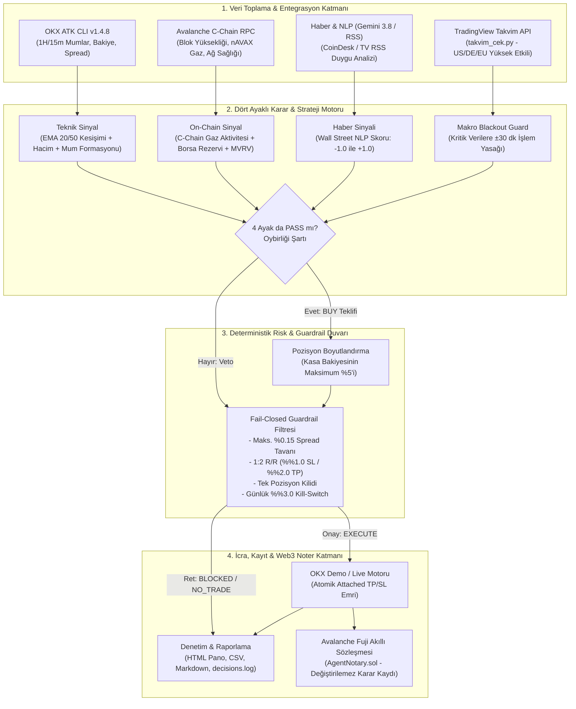

                                                 #🛡️ NEXA-TRADER

<div align="center">

**OKX Agent Trade Kit × Avalanche C-Chain Destekli Çok Kaynaklı Otonom Day Trading Ajanı**  
*Agentic Hackathon Ankara 2026 (OKX TR × Team1 Türkiye) için Geliştirilmiştir*

[](https://python.org)
[](https://github.com/okx/agent-trade-kit)
[](https://avax.network)
[](https://pytest.org)
[](https://github.com/aposalik/Neva-Trader)
[](LICENSE)

[Genel Bakış](#-genel-bakış) •
[Sistem Mimarisi](#-sistem-mimarisi-architecture) •
[4 Ayaklı Analiz Matrisi](#-4-ayaklı-analiz-matrisi) •
[Deterministik Koruma](#-deterministik-koruma-guardrails) •
[Hızlı Başlangıç](#-hızlı-başlangıç-quickstart) •
[Jüri Senaryoları](#-jüri-altın-demo-senaryoları) •
[Web3 Noter](#-avalanche-web3-noter-denetimi)

</div>

---

## 📌 Genel Bakış

**Nexa-Trader (Sentinel)**; kripto para piyasalarındaki yapay zeka halüsinasyonlarını, ani piyasa şoklarını ve kontrolsüz emir iletimi risklerini bertaraf etmek amacıyla geliştirilmiş **güvenlik öncelikli (safety-first)** ve **deterministik kurallara bağlı (fail-closed)** otonom bir alım-satım sistemidir.

BlackRock ve Team1 Türkiye'nin *"Güvenilir Agent"* standartlarını (Kimlik, Araçlar, Sınırlar, İzlenebilirlik) referans alan sistem:
* **OKX Agent Trade Kit (`@okx_ai/okx-trade-cli` v1.4.8+)** ile doğrudan spot borsa motoruna bağlanır.
* **4 Bağımsız Sinyal Ayağını (Teknik, On-Chain, Haber, Makro)** oybirliği (unanimous) şartıyla tartar.
* **Deterministik Risk Kalkanı (Guardrail)** ile sermayeyi matematiksel kurallarla korur.
* **Avalanche Fuji C-Chain (`AgentNotary.sol`)** akıllı sözleşmesi ile her kararını blokzincir üzerinde değiştirilemez biçimde mühürler.
* **Varsayılan olarak simülasyondur;** sıfır sermaye kaybı riskiyle çalışır.

---

## 🏗️ Sistem Mimarisi (Architecture)

Sistem, sorumlulukların kesin çizgilerle ayrıldığı **4 katmanlı reaktif bir boru hattı (pipeline)** mimarisine sahiptir:



---


## 🎯 4 Ayaklı Analiz Matrisi

Ajan, piyasada işlem açabilmek için 4 ayağın tamamından onay (`PASS`) almak zorundadır. **Tek bir ayak bile başarısız olursa işlem derhal veto edilir.**

| Sinyal Ayağı | Canlı Veri Kaynağı | Kabul Kriteri (PASS Koşulu) | Veto / Güvenlik Mekanizması |
| :--- | :--- | :--- | :--- |
| **1. Teknik Analiz** | OKX ATK CLI (`1H` & `15m` mumlar) | 1H EMA20 > EMA50, Kapanış > EMA20, 20 barlık ortalama hacim teyidi, 15m dönüş formasyonu (Engulfing / Hammer / Morning Star) | Trend zayıfsa veya hacim desteği yoksa alım yapılmaz. |
| **2. On-Chain Sağlık** | Avalanche C-Chain Public RPC (`api.avax.network`) + CryptoQuant | C-Chain blok üretimi ve gaz akışı aktif, borsa rezerv değişimi negatif ($\Delta < 0$), MVRV 1.0 - 2.5 aralığında | Ağ tıkanıklığında veya borsaya yüklü coin girişi (satış baskısı) anında kilitlenir. |
| **3. Haber & NLP** | Google Gemini 3.8 Flash + TradingView / CoinDesk RSS | Son 24 saatlik AVAX/BTC haberlerinin duygu skoru $\ge 0.0$ | Negatif regülasyon veya hack haberi geldiğinde tüm alımlar anında veto edilir. |
| **4. Makro Takvim** | TradingView Economic Calendar (`takvim_cek.py`) + OKX News API | ABD, Almanya ve Euro Bölgesi 3 yıldızlı (yüksek etkili) kritik verilerin olmaması | Açıklamaya **$\pm 30$ dakika** kala sistem otomatik **Blackout** moduna geçer ve işlem açmaz. |

---

## 🛡️ Deterministik Koruma (Guardrails)

Yapay zeka modelleri olasılıksal tahmin üretir; ancak para yönetimi **deterministik (kesin kurallı)** olmak zorundadır. `risk/guardrail.py` katmanı kod seviyesinde şu kilitleri uygular:

* 🔒 **Sermaye Koruma Tavanı:** Tek bir işlemde portföy bakiyesinin maksimum **%5.0**'i kullanılır (`max_notional_usd`).
* 🔒 **Dinamik 1:2 Risk/Kazanç (R/R):** Her alış emrinde borsa motoruna atomik olarak **%1.0 Zarar Durdur (SL)** ve **%2.0 Kâr Al (TP)** seviyeleri kilitlenir (`attached TP/SL`).
* 🔒 **Likidite & Spread Bariyeri:** Tahtadaki alış-satış makası (spread) **%0.15**'in üzerindeyse piyasa emri gönderilmez.
* 🔒 **Tek Pozisyon Kilidi:** Cüzdanda halihazırda açık bir AVAX pozisyonu varsa yeni pozisyon açılmaz; sermaye tek varlığa kilitlenmez.
* 🔒 **Acil Durdurma (Kill-Switch):** Günlük gerçekleşen toplam zarar **%3.0** seviyesine ulaştığı an sistem 24 saat boyunca tüm alımları kilitler.

---

## 📁 Proje Modüler Mimarisi

```text
Nexa-Trader/
├── main.py                     # Ana orkestrasyon motoru ve CLI arayüzü
├── config.json                 # Risk eşikleri, bakiye yüzdeleri ve ayak konfigürasyonu
├── takvim_cek.py               # TradingView ekonomik takvimini çeken ve güncelleyen modül
├── takvim_verileri.json         # Çekilen 7 günlük yüksek etkili US/DE/EU olay kütüğü
├── models.py                   # Tip güvenli veri sınıfları (PillarResult, Decision, OrderPlan)
├── ui.py                       # Zengin terminal panosu ve anlık durum tabloları
├── utils.py                    # Tarih, JSON ve loglama yardımcı fonksiyonları
│
├── data/                       # Veri Toplama Katmanı
│   ├── okx_client.py           # OKX ATK CLI Python wrapper (salt okunur sorgular)
│   ├── onchain.py              # Avalanche C-Chain RPC & zincir üstü metrik köprüsü
│   ├── news.py                 # Gemini NLP & RSS haber duygu analizi motoru
│   ├── macro.py                # Makro takvim normalizasyonu ve blackout guardrail'i
│   ├── history.py              # Karar geçmişi analizi ve istatistik üretici
│   └── trade_history.py        # OKX spot dolumlarını izleyen FIFO PnL takipçisi
│
├── strategy/                   # Strateji ve Sinyal Katmanı
│   ├── signal_engine.py        # 4 ayaklı oybirliği karar matrisi ve agentic reasoning
│   └── technical.py            # Pandas/NumPy EMA, hacim ve dönüş mumu algoritmaları
│
├── risk/                       # Risk ve Güvenlik Katmanı
│   ├── guardrail.py            # Deterministik güvenlik duvarı (Fail-Closed kontrolörü)
│   └── position_sizer.py       # Kesin 1:2 R/R pozisyon ve bakiye boyutlandırıcısı
│
├── execution/                  # İcra ve Web3 Katmanı
│   ├── executor.py             # OKX spot emir yürütücüsü (Attached TP/SL ile)
│   └── notary.py               # Avalanche Fuji C-Chain Web3 noter kayıt modülü
│
├── contracts/                  # Akıllı Sözleşmeler
│   └── AgentNotary.sol         # Avalanche üzerinde doğrulanabilir karar mühürleme kontratı
│
├── reports/                    # Canlı Denetim Raporları
│   ├── decisions_dashboard.html# Web tabanlı interaktif karar panosu
│   ├── decisions_table.md      # Markdown formatında denetim kütüğü
│   └── decisions_table.csv     # Excel uyumlu veri tablosu
│
└── tests/                      # Kapsamlı Test Paketi (28 Birim Testi)
    ├── test_guardrail.py       # Risk kilitleri ve R/R testleri
    ├── test_technical.py       # EMA kesişimleri ve mum formasyonu testleri
    ├── test_macro.py           # TradingView blackout testleri
    ├── test_history.py         # Karar geçmişi ve veto analizi testleri
    ├── test_trade_history.py   # Gerçekleşen PnL ve komisyon testleri
    ├── test_okx_compat.py      # Borsa CLI uyumluluk testleri
    └── test_cycle_data_failures.py # Veri kesintisi tolerans testleri
```

---

## 🚀 Hızlı Başlangıç (Quickstart)

### 1. Gereksinimler
* **Python:** 3.10 veya üzeri
* **Node.js:** v18+ (OKX CLI için)
* **OKX CLI:** `@okx_ai/okx-trade-cli`

### 2. Kurulum
```bash
# 1. Depoyu klonlayın
git clone https://github.com/aposalik/Neva-Trader.git
cd Neva-Trader

# 2. Sanal ortamı hazırlayın ve bağımlılıkları kurun
python3 -m venv .venv
source .venv/bin/activate       # Windows: .venv\Scripts\activate
pip install -r requirements.txt

# 3. OKX Agent Trade Kit CLI aracını kurun
npm install -g @okx_ai/okx-trade-cli

# 4. Çevre değişkenleri şablonunu oluşturun
cp .env.example .env
```

### 3. OKX Demo Oturumu Açma
API anahtarı oluşturmanıza gerek yoktur; OKX CLI tarayıcı üzerinden tek tıkla OAuth doğrulaması yapar:
```bash
okx auth login
```
*(Bakiye kontrolü için: `okx account balance --demo`)*

---

## 💻 Çalıştırma Modları ve Parametreler

```bash
# Tek seferlik canlı analiz
python main.py --once

# Her 30 saniyede bir otonom analiz döngüsü
python main.py --loop 30

# Sanal makro kriz simülasyonu (TÜFE'ye 8 dk kala)
python main.py --simulate-event "US CPI in 8m"

# Son 30 günlük kararları ve PnL performansını analiz et
python main.py --review-history

# TradingView takvimini manuel yenile
python takvim_cek.py
```

### Dinamik Risk Parametreleri (Terminalden Özelleştirme)
```bash
# Örnek: Bakiyenin %10'u ile gir, %1.5 SL ve %3.0 TP uygula
python main.py --capital-pct 10.0 --sl-pct 1.5 --tp-pct 3.0

# Terminal üzerinden interaktif soru-cevap ile kural belirle
python main.py --set-rules --loop 30
```

---

## ⛓️ Avalanche Web3 Noter Denetimi

Ajanın verdiği her alım veya veto kararı, yerel dosyalarda tutulduğu gibi **Avalanche Fuji Testnet** üzerindeki [**`contracts/AgentNotary.sol`**](file:///Users/abdullahsalik/.openclaw/workspace/Nexa-Trader/contracts/AgentNotary.sol) akıllı sözleşmesine kriptografik hash olarak mühürlenir:

* **Ağ:** Avalanche Fuji Testnet (Chain ID: `43113`)
* **Doğrulanabilirlik:** Karar metni, zaman damgası ve sinyal durumu birleştirilerek `keccak256` hash'i alınır.
* **Şeffaflık:** Jüri veya fon yöneticisi, [Snowtrace Fuji Explorer](https://testnet.snowtrace.io) üzerinden ajanın geçmiş kararlarını ve blok zamanlarını üçüncü bir tarafa ihtiyaç duymadan denetleyebilir.

---

## 🧪 Birim Testleri (Verification)

Sistemin tüm matematiksel hesaplamaları, mum formasyonları ve güvenlik kilitleri `pytest` ile test edilmiştir:

```bash
pytest -v
```

```text
============================== test session starts ==============================
collected 28 items

tests/test_cycle_data_failures.py::test_cycle_blocks_trade_when_balance_cannot_be_read PASSED
tests/test_guardrail.py::test_position_sizer_exact_rr PASSED
tests/test_guardrail.py::test_guardrail_spread_block PASSED
tests/test_guardrail.py::test_guardrail_open_position_block PASSED
tests/test_guardrail.py::test_guardrail_kill_switch_block PASSED
tests/test_history.py::test_history_analysis_summarizes_vetoes_and_discloses_missing_pnl PASSED
tests/test_macro.py::test_tradingview_calendar_event_blocks_trading PASSED
tests/test_okx_compat.py::test_okx_client_supports_legacy_is_demo_parameter PASSED
tests/test_technical.py::test_calculate_ema PASSED
tests/test_technical.py::test_detect_bullish_engulfing_positive PASSED
tests/test_technical.py::test_detect_hammer_positive PASSED
tests/test_technical.py::test_detect_morning_star_positive PASSED
tests/test_trade_history.py::test_tracker_calculates_fee_adjusted_realized_pnl_and_deduplicates PASSED
...
============================== 28 passed in 0.43s ==============================
```

---

<div align="center">
Geliştirici Ekip: <b>Abdullah Salık</b> • <b>İrem Yağmur</b> • <b>Yusuf Doğan</b>  
<i>OKX TR & Avalanche Agentic Hackathon Ankara 2026</i>
</div>
