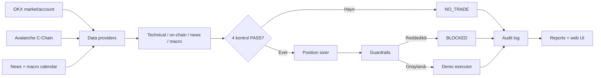

                                                #🛡️ NEXA-TRADER

<div align="center">

**AVAX-USDT için açıklanabilir, risk kontrollü ve demo-öncelikli işlem karar sistemi**

*OKX Agent Trade Kit + Avalanche C-Chain veri kaynaklarıyla geliştirilen hackathon projesi*

[](https://www.python.org/)
[](https://github.com/okx/agent-trade-kit)
[](https://docs.pytest.org/)

</div>

> [!WARNING]
> Nexa-Trader finansal tavsiye değildir. Varsayılan çalışma modu **OKX demo hesabıdır**; yine de `--demo-script` gerçek bir demo emri gönderebilir. Emir göndermeden test etmek için `--dry-run` kullanın.

## İçindekiler

- [Nedir?](#nedir)
- [Mevcut durum](#mevcut-durum)
- [Mimari](#mimari)
- [Karar mantığı](#karar-mantığı)
- [Risk kuralları](#risk-kuralları)
- [Kurulum](#kurulum)
- [Çalıştırma](#çalıştırma)
- [Web kontrol merkezi](#web-kontrol-merkezi)
- [Test ve doğrulama](#test-ve-doğrulama)
- [Jüri/demo senaryoları](#jüridemo-senaryoları)
- [Veri kaynakları ve fallback davranışı](#veri-kaynakları-ve-fallback-davranışı)
- [Proje yapısı](#proje-yapısı)
- [Güvenlik sınırları](#güvenlik-sınırları)
- [Bilinen sınırlamalar](#bilinen-sınırlamalar)
- [Katkı](#katkı)

## Nedir?

Nexa-Trader, AVAX-USDT için piyasa verilerini dört bağımsız kontrolde birleştirir:

1. **Teknik analiz:** 1H trendi ve 15m giriş formasyonlarını inceler.
2. **On-chain analiz:** Avalanche C-Chain ve yapılandırılmış zincir üstü metrikleri değerlendirir.
3. **Haber/duyarlılık:** AVAX ve BTC haber duyarlılığını kontrol eder.
4. **Makro takvim:** Yüksek etkili ekonomik olayların işlem blackout penceresini uygular.

Dört kontrolün tamamı geçmeden işlem fikri `BUY` olmaz. Bir kontrol başarısızsa sistem `NO_TRADE`; sinyaller geçse bile risk kapısı reddederse `BLOCKED` üretir.

## Mevcut durum

- Varsayılan instrument: `AVAX-USDT`
- Varsayılan hesap modu: **OKX DEMO**
- Spot işlem mantığı; kaldıraç/marjin/short stratejisi yok
- Web arayüzünde canlı OKX mumları, demo cüzdanı, P&L, karar kaydı ve demo ajan kontrolü bulunur
- Web arayüzü canlı hesap modunu açamaz
- Test durumu: **33 test geçti**

## Mimari



### Ana karar akışı


## 🎯 4 Ayaklı Analiz Matrisi

Ajan, piyasada işlem açabilmek için 4 ayağın tamamından onay (`PASS`) almak zorundadır. **Tek bir ayak bile başarısız olursa işlem derhal veto edilir.**

## Karar mantığı

| Durum | Anlamı |
|---|---|
| `BUY` | Dört sinyal de geçti ve risk kapısı emir planını onayladı. |
| `NO_TRADE` | En az bir sinyal hazır değil veya veto verdi; emir gönderilmez. |
| `BLOCKED` | Sinyaller uygun görünse bile bakiye, spread, pozisyon, günlük limit veya makro guardrail işlemi durdurdu. |
| `DRY-RUN` | Karar ve emir planı hesaplanır, borsaya emir gönderilmez. |
| `DEMO` | OKX demo API’si kullanılır; bakiye ve emirler sanaldır. |
| `LIVE` | CLI’de mevcut olan canlı hesap modu; web kontrolünden kapalıdır ve dikkat gerektirir. |

## Risk kuralları

Değerler `config.json` içinden okunur ve `--set-rules` veya CLI parametreleriyle değiştirilebilir.

| Kural | Varsayılan |
|---|---:|
| İşlem başına bakiye | `%5` |
| Stop-loss | `%1` |
| Take-profit | `%2` |
| Risk/kazanç | `1:2` |
| Günlük maksimum işlem | `4` |
| Günlük maksimum zarar | `%3` |
| Maksimum spread | `%0.15` |
| Minimum pozisyon | `5 USDT` |

Ek korumalar:

- Bakiye, ticker, instrument veya açık emir verisi okunamazsa işlem bloke edilir.
- Mevcut AVAX pozisyonu veya koruma emri varsa yeni pozisyon açılmaz.
- Pozisyon boyutu `Decimal` hesaplarıyla ve OKX `lotSz`/`tickSz` kurallarıyla yuvarlanır.
- Karar ve icra sonuçları `decisions.log` ve rapor dosyalarına yazılır.

## Kurulum

### Gereksinimler

- Python `3.10+`
- Node.js ve npm
- OKX Agent Trade Kit CLI `1.4.8+`
- OKX demo hesabı veya yalnızca test için mock/fallback kaynaklar

### Depoyu hazırlama

```bash
git clone https://github.com/aposalik/Neva-Trader.git
cd Neva-Trader

python3 -m venv .venv
source .venv/bin/activate        # Windows: .venv\Scripts\activate
python -m pip install -r requirements.txt
npm install -g @okx_ai/okx-trade-cli
```

### OKX CLI oturumu

```bash
okx auth login
```

API anahtarlarını README’ye, kaynak koda veya loglara yazmayın. `.env.example` dosyasını gerekiyorsa `.env` olarak kopyalayın; `.env` commit edilmez.

```bash
cp .env.example .env
```

## Çalıştırma

### Güvenli ilk doğrulama — emir göndermez

```bash
.venv/bin/python main.py --once --dry-run
```

Bu komut canlı veri kaynaklarını okuyup karar üretir; OKX’e emir göndermez.

## 💻 Çalıştırma Modları ve Parametreler

```bash
.venv/bin/python main.py --set-rules --save-rules --once --dry-run
```

CLI ile doğrudan örnek:

```bash
.venv/bin/python main.py \
  --capital-pct 5 \
  --sl-pct 1 \
  --tp-pct 2 \
  --max-daily-trades 4 \
  --max-daily-loss-pct 3 \
  --once --dry-run
```

### Yardım

```bash
.venv/bin/python main.py --help
```

## Web kontrol merkezi

Web arayüzü; OKX demo hesabı ve OKX market API’sinden gelen verileri yerel olarak gösterir:

- Canlı `1m`, `5m`, `15m`, `1H`, `4H` mum grafiği
- OKX demo bakiyesi ve AVAX varlığı
- Gerçekleşen/gerçekleşmemiş P&L
- Açık emir ve koruma emri sayısı
- Son karar ve dört sinyal matrisi
- Demo ajanını başlat/durdur
- `--set-rules` akışının doğrulanan web karşılığı

Başlatın:

```bash
.venv/bin/python website/server.py
```

Ardından açın:

<http://127.0.0.1:8787>

> Web sunucusu varsayılan olarak `127.0.0.1` üzerinde çalışır. Canlı hesap modu, keyfi shell komutları ve web üzerinden serbest emir gönderimi açılmaz.

## Test ve doğrulama

Tüm testleri çalıştırın:

```bash
.venv/bin/python -m pytest -q
```

Beklenen mevcut sonuç:

```text
33 passed
```

JavaScript/Python sözdizimi kontrolü:

```bash
node --check website/app.js
.venv/bin/python -m py_compile \
  data/okx_client.py \
  website/server.py \
  website/live_data.py \
  website/agent_control.py
```

OKX bağlantısını salt okunur kontrol edin:

```bash
.venv/bin/python test_flow.py
```

## Jüri/demo senaryoları

Üç karar yolunu simüle eder:

```bash
.venv/bin/python main.py --demo-script --dry-run
```

| Senaryo | Beklenen sonuç |
|---|---|
| Tüm ayaklar yeşil | `BUY` adayı; mevcut pozisyon veya risk guardrail’i yine engelleyebilir. |
| Negatif haber | `NO_TRADE` |
| Makro blackout | `BLOCKED` veya `NO_TRADE` |

`--demo-script` tek başına kullanılırsa senaryo 1’de OKX demo hesabına emir gönderme ihtimali vardır. İlk testte her zaman `--dry-run` kullanın.

### Gerçek demo emri

Bu komut demo hesabında emir denemesi yapabilir:

```bash
.venv/bin/python test_flow.py --submit-demo-order
```

Bu birim test değildir; OKX demo hesabında dış etki oluşturabilecek bir entegrasyon testidir. Çalıştırmadan önce hesabı ve açık pozisyonları kontrol edin.

## Veri kaynakları ve fallback davranışı

| Kaynak | Kullanım | Başarısızlık davranışı |
|---|---|---|
| OKX CLI | Ticker, mum, bakiye, instrument, emir ve dolumlar | Kritik hesap/piyasa verisi yoksa işlem `BLOCKED` olur. |
| Avalanche C-Chain RPC | On-chain metrikler | Doğrulanamayan metrikler `FALLBACK`/mock olarak etiketlenir. |
| OKX news / RSS / opsiyonel Gemini | Haber duyarlılığı | Fallback kullanılırsa kaynak etiketi korunur. |
| TradingView/OKX ekonomik takvim | Makro blackout | Takvim erişimi veya normalizasyon sorunu karar akışına yansıtılır. |

Mock, simulated ve fallback kayıtları gerçek piyasa kanıtı olarak değerlendirilmemelidir.

## Proje yapısı

```text
Nexa-Trader/
├── main.py                 # Orkestrasyon motoru ve CLI
├── config.json             # Risk, teknik ve veri kaynağı ayarları
├── models.py               # PillarResult, Decision, OrderPlan modelleri
├── data/
│   ├── okx_client.py       # OKX CLI sarmalayıcısı
│   ├── onchain.py          # Avalanche veri erişimi
│   ├── news.py             # Haber/duyarlılık akışı
│   ├── macro.py            # Takvim ve blackout kontrolü
│   ├── history.py          # Karar geçmişi raporu
│   └── trade_history.py    # FIFO dolum ve P&L takibi
├── strategy/
│   ├── technical.py        # EMA, hacim ve mum formasyonları
│   └── signal_engine.py    # Dört ayaklı karar birleştirme
├── risk/
│   ├── guardrail.py        # Fail-closed risk kontrolleri
│   └── position_sizer.py   # Pozisyon ve TP/SL hesaplama
├── execution/
│   ├── executor.py         # Demo/CLI emir yürütme
│   └── notary.py           # Opsiyonel Avalanche Fuji noter katmanı
├── website/                # Türkçe varsayılan web kontrol merkezi
├── contracts/              # AgentNotary.sol
├── tests/                  # Birim ve entegrasyon uyumluluk testleri
├── decisions.log           # Yerel karar günlüğü
└── reports/                # HTML, CSV ve Markdown raporları
```

## Güvenlik sınırları

<div align="center">
Geliştirici Ekip: <b>Abdullah Salık</b> • <b>İrem Yağmur</b> • <b>Yusuf Doğan</b>  
<i>OKX TR & Avalanche Agentic Hackathon Ankara 2026</i>
</div>
